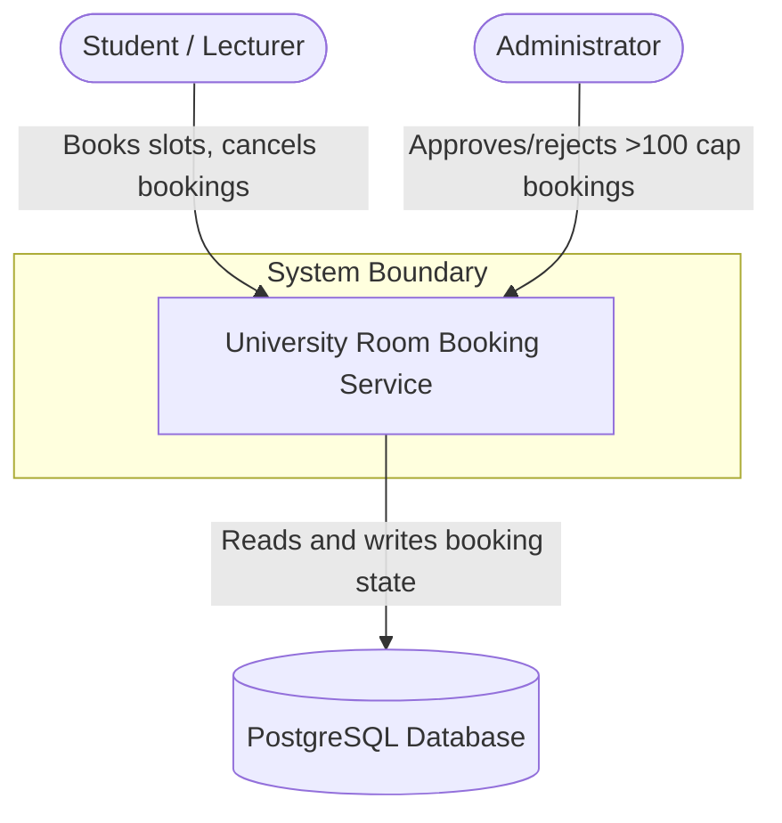
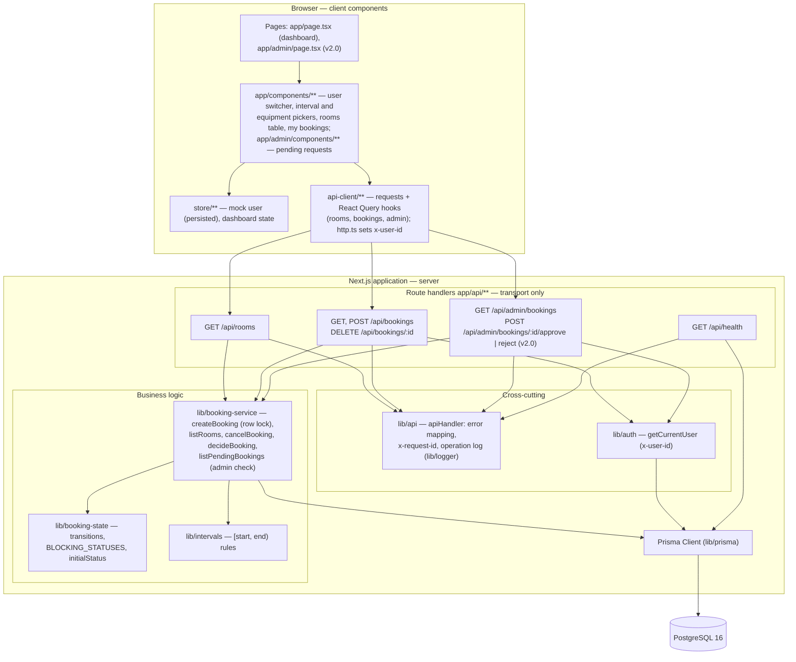

# Контекстна та компонентна схеми

## Контекстна схема (System Context Diagram)



## Схема компонентів (Component Diagram)

Matches `v2.0`. Folder names are the real ones in the repository.



## Діаграма послідовності: створення бронювання (Sequence Diagram)

Required by lab Section 5. Covers the booking creation path, including the concurrency conflict branch governed by ADR-001 and the v2.0 initial status.

```mermaid
sequenceDiagram
    actor U as User (Student)
    participant UI as Browser UI
    participant API as POST /api/bookings
    participant Auth as lib/auth
    participant Svc as lib/booking-service
    participant DB as PostgreSQL

    U->>UI: Pick room + interval, click "Book"
    UI->>API: POST /api/bookings (x-user-id, roomId, startTime, endTime)
    API->>Auth: getCurrentUser(req)
    Auth->>DB: find user by x-user-id
    Auth-->>API: user (or 401 Unauthorized)
    API->>Svc: createBooking(user, roomId, start, end)
    Svc->>Svc: validate startTime < endTime (else 400)
    Svc->>DB: BEGIN; SELECT id, capacity FROM room FOR UPDATE (404 if none)
    Svc->>DB: find overlapping bookings in BLOCKING_STATUSES [ACTIVE, PENDING], [start, end)
    alt No overlap
        Svc->>DB: INSERT booking (status = initialStatus: ACTIVE, or PENDING if capacity > 100); COMMIT
        Svc-->>API: booking
        API-->>UI: 201 Created
    else Overlap exists
        Svc->>DB: ROLLBACK
        Svc-->>API: ConflictError
        API-->>UI: 409 Conflict
    end
```
