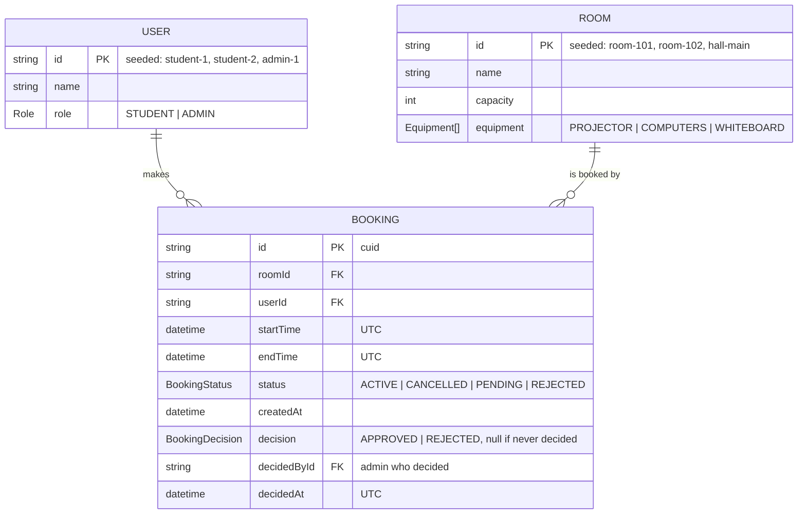
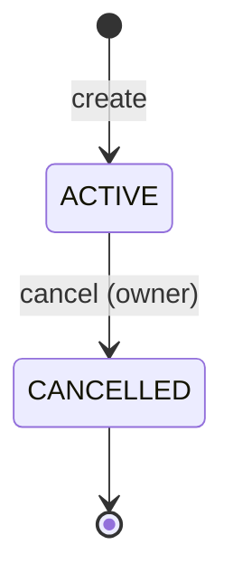
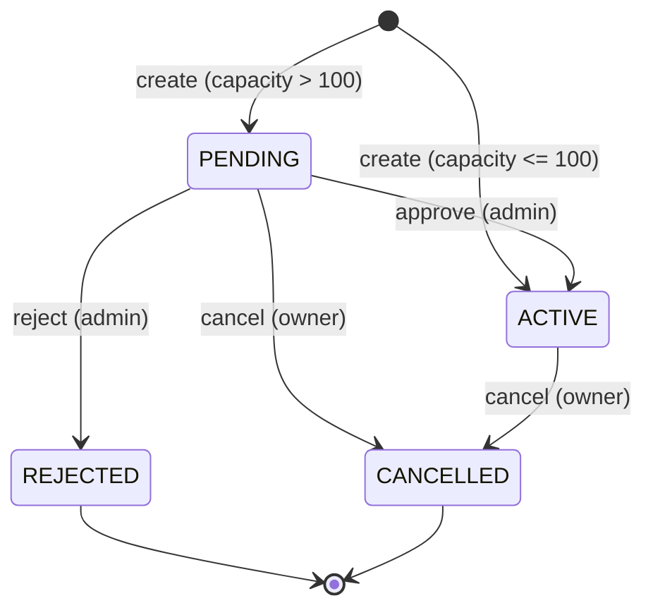

# Domain model (v2.0)

## Entities

## Room equipment (BOOK-22)

Seeded: `room-101` projector + whiteboard, `room-102` computers + projector,
`hall-main` projector + whiteboard. Users filter rooms by it; it does not
affect booking rules.

## Business invariants

- **Interval validity:** `startTime < endTime` for every booking.
- **No overlap:** for one room, no two bookings in a *blocking* status may
  have overlapping intervals. Intervals use `[start, end)` semantics:
  adjacency is allowed, partial/full overlap is forbidden.
- **Blocking statuses:** v1.0 `{ACTIVE}`, v2.0 `{ACTIVE, PENDING}`. Defined
  in exactly one place: `BLOCKING_STATUSES` in `lib/booking-state.ts`.
- **Approval (v2.0):** a booking of a room with capacity > 100 starts as
  `PENDING`; smaller rooms keep the v1.0 behaviour (immediately `ACTIVE`).
- **Ownership:** only the owner may cancel a booking, including withdrawing
  a `PENDING` request (server-enforced).

## Booking state machine — v1.0

## Booking state machine — v2.0 (lab section 10, `lib/booking-state.ts`)

v2.0 changes: `PENDING` joins the blocking set (a pending request reserves
its slot), decisions are audited (author, time, result), and ADR-001 is
reviewed against the new blocking set.

## Glossary

| Term | Meaning |
|---|---|
| Booking | Reservation of one room by one user for one time interval |
| Slot | A room + time interval combination |
| Blocking status | Booking status that reserves its slot against overlaps |
| `[start, end)` | Interval semantics: inclusive start, exclusive end |
| Mock auth | Identity passed via `x-user-id` header (training only) |
| Correlation id | `x-request-id` linking log entries of one operation |
